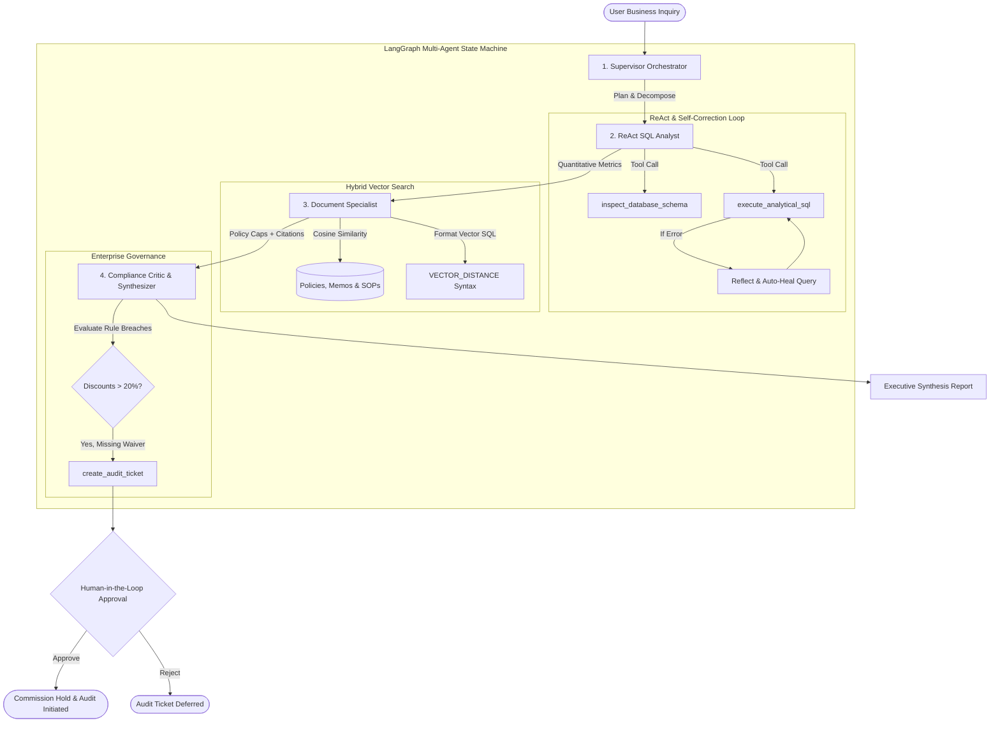

# NexusOps AI — Autonomous Enterprise Data Analyst & Operations Agent

**NexusOps AI** is an enterprise-grade multi-agent autonomous system built with **LangGraph** that investigates complex business inquiries by combining **relational ERP SQL databases** with **unstructured corporate policy vector search**, enforcing **read-only guardrails**, and staging **Human-in-the-Loop (HITL)** governance actions.

---

## Core Capabilities

| Capability | Implementation | Code Location |
| :--- | :--- | :--- |
| **Stateful Multi-Agent Orchestration** | LangGraph `StateGraph` tracking query plans, SQL outputs, vector hits, compliance violations, and HITL gates. | [`src/graph.py`](src/graph.py), [`src/agents/state.py`](src/agents/state.py) |
| **Supervisor / Task Decomposition** | Decomposes executive questions into quantitative SQL analysis, semantic policy retrieval, and compliance checks. | [`src/agents/supervisor.py`](src/agents/supervisor.py) |
| **ReAct SQL Analyst & Self-Healing** | Inspects schemas (`inspect_database_schema`), executes SQL (`execute_analytical_sql`), and repairs errors via reflection. | [`src/agents/sql_analyst.py`](src/agents/sql_analyst.py) |
| **Hybrid Semantic Vector Search** | TF-IDF + NumPy cosine similarity search with metadata filtering and Oracle 23ai `VECTOR_DISTANCE` SQL generation. | [`src/db/vector_store.py`](src/db/vector_store.py), [`data/oracle_23ai_schema.sql`](data/oracle_23ai_schema.sql) |
| **Read-Only Security Guardrails** | Blocks destructive SQL keywords (`DROP`, `DELETE`, `TRUNCATE`, `ALTER`, `UPDATE`) during analytical execution. | [`src/db/relational.py`](src/db/relational.py) |
| **Human-in-the-Loop (HITL) Gate** | Automatically drafts audit tickets (`PENDING_APPROVAL`) when policy caps are breached and awaits human sign-off. | [`src/tools/ops_tools.py`](src/tools/ops_tools.py), [`src/agents/critic.py`](src/agents/critic.py) |
| **Monochrome Web Console** | Starlette + Uvicorn web app with an instant **Black / White** theme switch, SVG analytics chart, and HITL console. | [`web_app.py`](web_app.py), [`frontend/index.html`](frontend/index.html) |

---

## Multi-Agent Workflow Architecture



---

## Project Structure

```text
nexusops-ai/
├── README.md                          # Documentation & architecture guide
├── .gitignore                         # Ignores .venv, .env, caches, and logs
├── pyproject.toml                     # Python 3.12+ dependencies managed via uv
├── .env.example                       # Optional API & DB configuration template
├── web_app.py                         # Starlette + Uvicorn ASGI web server & REST API
│
├── frontend/
│   └── index.html                     # Monochrome Black/White SPA (Charts, SQL Lab, HITL Console)
│
├── data/
│   ├── enterprise_data.db             # Pre-seeded SQLite relational database
│   ├── vector_index.json              # Pre-computed semantic vector index
│   ├── oracle_23ai_schema.sql         # Production Oracle 23ai DDL (VECTOR type & HNSW index)
│   └── documents/                     # Unstructured corporate policies & CFO memos
│       ├── corporate_discount_policy.txt
│       ├── q3_2024_cfo_memo.txt
│       └── compliance_audit_playbook.txt
│
├── src/
│   ├── config.py                      # Configuration & compliance threshold settings
│   ├── db/
│   │   ├── relational.py              # Schema inspection & guarded SQL executor
│   │   ├── vector_store.py            # Cosine similarity vector engine + 23ai SQL formatter
│   │   └── seed_data.py               # Enterprise dataset & vector index seeder
│   ├── tools/
│   │   ├── sql_tools.py               # ReAct tools for SQL Analyst
│   │   ├── doc_tools.py               # Vector search tools for Document Specialist
│   │   └── ops_tools.py               # Audit ticket drafting & HITL approval tools
│   ├── agents/
│   │   ├── state.py                   # LangGraph TypedDict state
│   │   ├── llm_client.py              # Model adapter (OpenAI, Groq, offline heuristic mode)
│   │   ├── supervisor.py              # Query decomposition & planning
│   │   ├── sql_analyst.py             # ReAct SQL Analyst with self-healing reflection
│   │   ├── doc_specialist.py          # Document retriever & vector query generator
│   │   └── critic.py                  # Policy compliance verification & synthesis
│   ├── graph.py                       # Compiled LangGraph multi-agent workflow
│   └── cli.py                         # Rich terminal CLI with interactive HITL prompt
│
└── tests/
    └── test_workflow.py               # Unit & end-to-end integration tests
```

---

## Quickstart Guide

### 1. Prerequisites
- Python 3.12+
- [`uv`](https://docs.astral.sh/uv/) package manager

### 2. Install Dependencies
```bash
uv sync
```

### 3. Run the Interactive Web Dashboard
```bash
uv run python web_app.py
```
Open **[http://localhost:8501](http://localhost:8501)** in your browser to:
- Toggle seamlessly between **Black (Obsidian)** and **White (Crisp)** themes.
- Launch pre-built enterprise investigation scenarios or enter custom prompts.
- Inspect the step-by-step **Reasoning Trace**, **SQL Lab**, **Vector Search**, and **Regional Operating Margin** chart.
- Approve or reject staged audit incidents in the **HITL Governance Console**.

### 4. Run via Command Line Interface (CLI)
```bash
uv run python -m src.cli
```

### 5. Run Tests
```bash
uv run python -m unittest tests.test_workflow
```

---

## Optional: Connecting Live LLMs & Oracle Database 23ai

The project runs **100% locally out of the box** without external API keys. To enable live LLM inference or connect an Oracle Database 23ai instance:

1. Copy `.env.example` to `.env`:
   ```bash
   cp .env.example .env
   ```
2. Add your LLM provider settings (`OPENAI_API_KEY` or `GROQ_API_KEY`) and/or database credentials:
   ```env
   LLM_PROVIDER=openai
   OPENAI_API_KEY=your_api_key_here

   ORACLE_23AI_ENABLED=true
   ORACLE_USER=admin
   ORACLE_PASSWORD=your_password
   ORACLE_DSN=localhost:1521/FREEPDB1
   ```
3. Apply the schema in [`data/oracle_23ai_schema.sql`](data/oracle_23ai_schema.sql) to create the `VECTOR(384, FLOAT32)` table and HNSW vector index.

---

## License

This project is open-source and available under the **MIT License** — you are free to use, modify, and distribute this software for personal or commercial purposes with attribution (`Copyright (c) 2026 hegdeshrinivas1`). Provided "as is", without warranty of any kind.

